<p align="center">
  <picture>
    <source media="(prefers-color-scheme: dark)" srcset="brand/exclip-lockup-white.svg">
    
  </picture>
</p>

<h3 align="center">Cross-chain swaps you can run yourself.</h3>

<p align="center">
  ExClip is an open-source front end for <a href="https://sodax.com">SODAX</a>. People pay on one network and
  receive on another, with the wallet they already have or with a passkey wallet built in: no extension to install,
  and no seed phrase to type. Anyone can run a copy under their own name, and it charges no fee unless they set one.
</p>

<p align="center">
  <a href="LICENSE"></a>
  <a href="https://github.com/ColdAI-org/exclip/actions/workflows/ci.yml"></a>
  
  <a href="#fees"></a>
  
</p>

<p align="center">
  <a href="#quick-start">Quick start</a> ·
  <a href="#configuration">Configuration</a> ·
  <a href="#self-hosting">Self-hosting</a> ·
  <a href="#run-your-own-branded-exclip">Your own brand</a> ·
  <a href="#how-it-works">How it works</a> ·
  <a href="#security">Security</a> ·
  <a href="docs/README.md">Documentation</a>
</p>

> [!WARNING]
> **Preview, not audited.** No independent firm has audited ExClip yet. It
> has no test-network mode: every swap is real, and SODAX settles it on live
> networks with real funds. Try each flow with small amounts first. If you
> run a copy, read [operator responsibility](#operator-responsibility).

## Why ExClip

**One signature, two networks.** Pay with USDC on Base and receive ETH on
Arbitrum. Your wallet signs one transaction on the network you pay from,
after a token approval if one is needed. SODAX's solvers compete to fill it,
and what you bought arrives on the network you chose. ExClip never holds the
funds, and it has no bridge or order book of its own.

**A wallet in one step.** People can trade with the wallet they already use,
from any of nine wallet families. Or they can create a self-custodial
passkey wallet, with no extension to install and no seed phrase to copy. It
opens in a window on its own origin, checks every byte it signs against what
the person asked for, and shows its own review before the passkey prompt.

**No secret in the browser.** The SODAX API key stays on the server, and the
app holds no secret at all. The server never gets a user's key: it keeps
passkey-wallet backups that only the user's passkey can open.

**Yours to run.** One file sets your name, logo, colours, domains and fee.
One Node process can serve the app, the wallet and the API. The fee is zero
unless you set one, and the passkey wallet refuses any fee to a receiver
nobody added to its list.

## See it

<table>
  <tr>
    <td width="50%"><picture><source media="(prefers-color-scheme: dark)" srcset="docs/media/home-dark-desktop.png">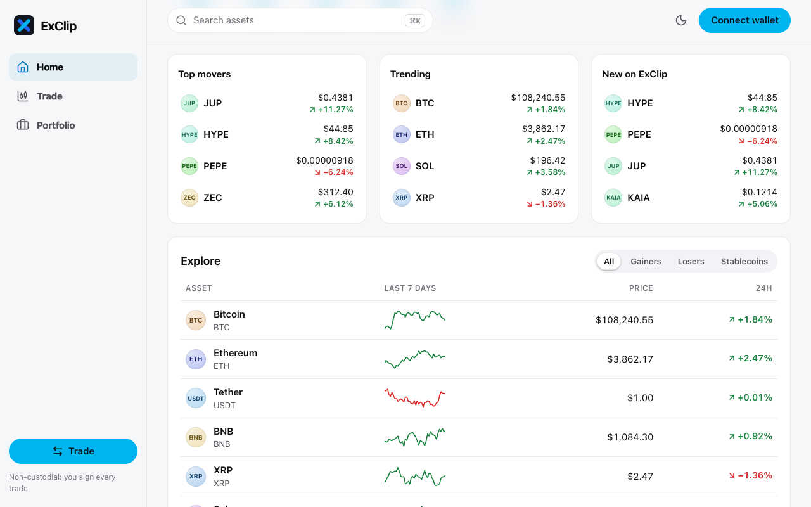</picture></td>
    <td width="50%"><picture><source media="(prefers-color-scheme: dark)" srcset="docs/media/trade-dark-desktop.png">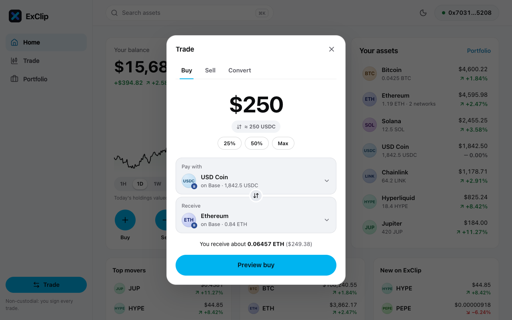</picture></td>
  </tr>
  <tr>
    <td align="center"><sub>Home: the markets at a glance</sub></td>
    <td align="center"><sub>A swap with its quote</sub></td>
  </tr>
  <tr>
    <td><picture><source media="(prefers-color-scheme: dark)" srcset="docs/media/portfolio-dark-desktop.png">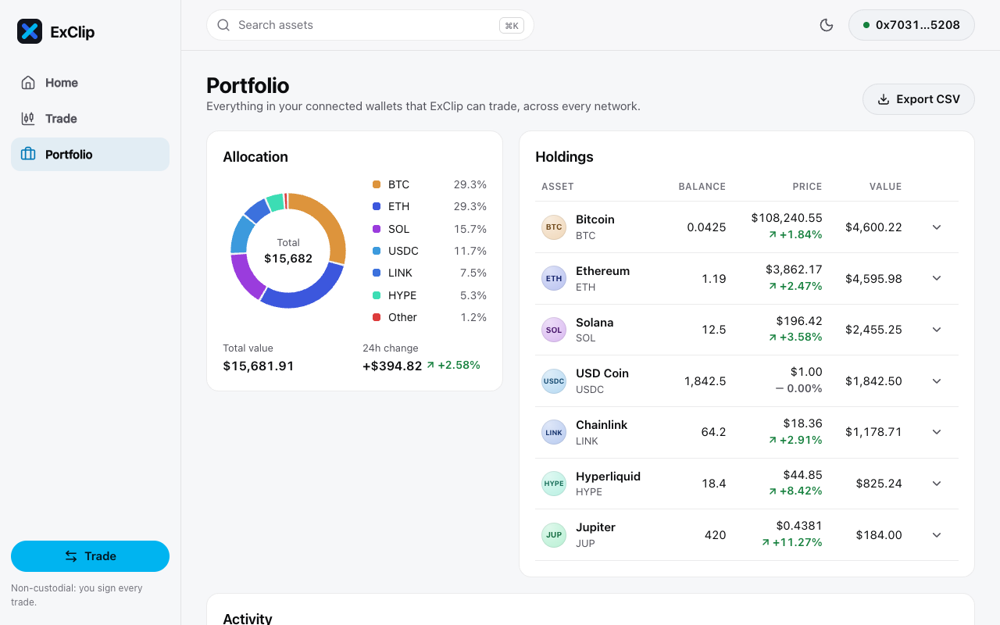</picture></td>
    <td><picture><source media="(prefers-color-scheme: dark)" srcset="docs/media/asset-dark-desktop.png">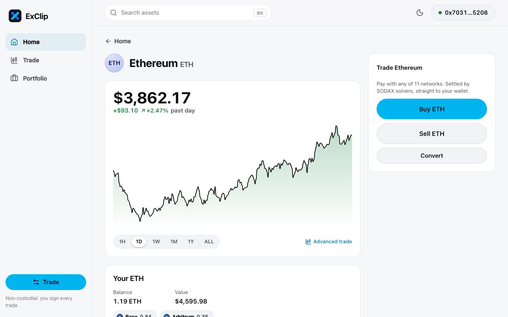</picture></td>
  </tr>
  <tr>
    <td align="center"><sub>Portfolio: what you hold, on every network</sub></td>
    <td align="center"><sub>An asset's page</sub></td>
  </tr>
</table>

<table>
  <tr>
    <td width="33%"><picture><source media="(prefers-color-scheme: dark)" srcset="docs/media/approval-dark-desktop.png">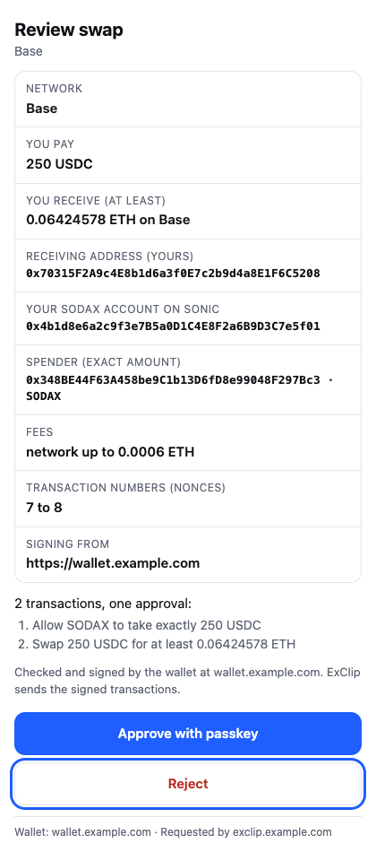</picture></td>
    <td width="33%"><picture><source media="(prefers-color-scheme: dark)" srcset="docs/media/trade-dark-phone.png">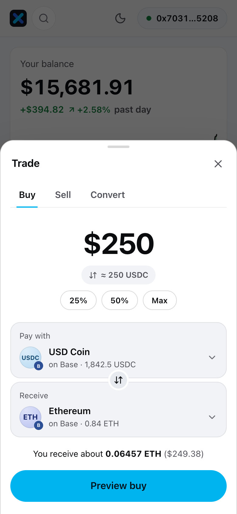</picture></td>
    <td width="33%"><picture><source media="(prefers-color-scheme: dark)" srcset="docs/media/asset-dark-phone.png">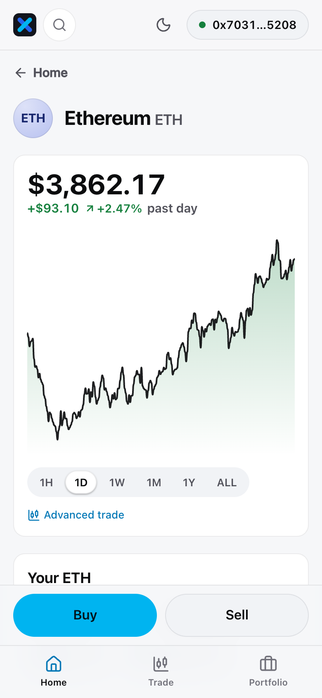</picture></td>
  </tr>
  <tr>
    <td align="center"><sub>The passkey wallet's own review, before the passkey prompt</sub></td>
    <td align="center"><sub>The same swap on a phone</sub></td>
    <td align="center"><sub>An asset on a phone</sub></td>
  </tr>
</table>

<details>
<summary><b>More screens</b> on a phone</summary>
<br>

<table>
  <tr>
    <td width="33%"><picture><source media="(prefers-color-scheme: dark)" srcset="docs/media/home-dark-phone.png">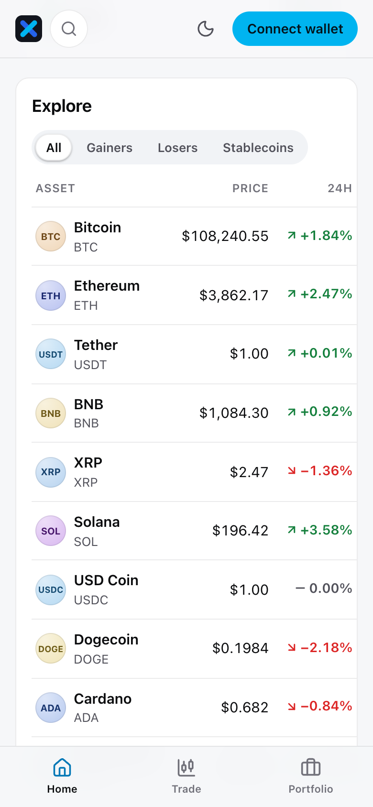</picture></td>
    <td width="33%"><picture><source media="(prefers-color-scheme: dark)" srcset="docs/media/portfolio-dark-phone.png">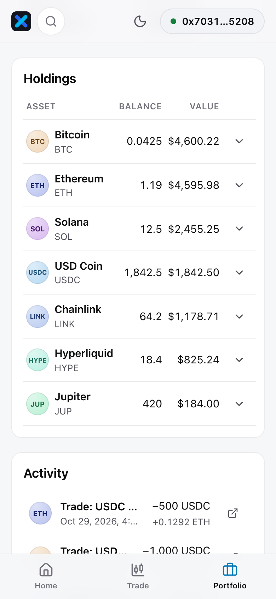</picture></td>
    <td width="33%"><picture><source media="(prefers-color-scheme: dark)" srcset="docs/media/approval-dark-phone.png">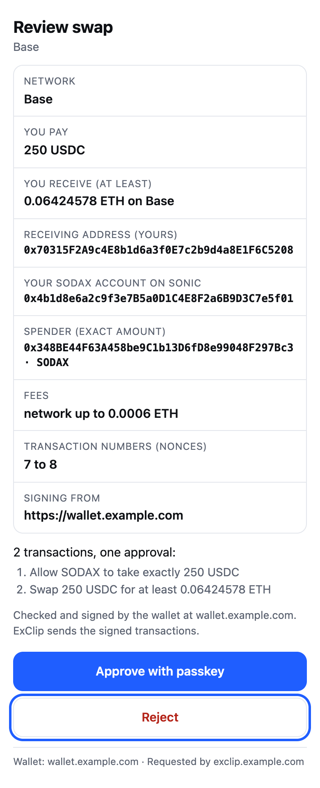</picture></td>
  </tr>
  <tr>
    <td align="center"><sub>Home</sub></td>
    <td align="center"><sub>Portfolio</sub></td>
    <td align="center"><sub>The passkey wallet's review</sub></td>
  </tr>
</table>
</details>

Light or dark follows your system's theme. The prices, balances and account
in these screenshots are made up, and no request left the machine while
they were taken. `pnpm run screenshots` takes them again
([screenshots](docs/development.md#screenshots)).

## Features

- **Market swaps** between the assets SODAX lists, across its networks. The
  quote refreshes every 20 seconds while you review it. The review shows the
  rate, the minimum you receive at your slippage (0.1, 0.5 or 1 %), the fees
  and an estimated time.
- **Limit orders** from a pair's page, such as `/trade/BTC-USDC`. They last
  1 hour, 1 day, 7 days, 30 days, or until they fill or you cancel them, and
  they can fill in parts. They need a browser wallet for now.
- **36 assets on 22 networks** in the catalogue. SODAX's token list says
  where each asset trades, so a new SODAX listing of a catalogue asset
  appears without a release.
- **Browser wallets from nine families:** EVM, Solana, Sui, Bitcoin,
  Stellar, NEAR, Injective, Stacks and ICON. Clip Wallet is listed first
  when it's installed.
- **The passkey wallet:** market swaps, sends and receives on 14 EVM
  networks, with one address on all of them and a table of 238 tokens it can
  name on its review. Encrypted backups on the server, the 12-word recovery
  phrase on request, and a move to Clip Wallet at any time.
- **Markets and a portfolio:** prices, charts and stats from CoinGecko,
  through the server; a page for each asset and each pair; balances read
  straight from the networks; and a trade history that stays in the browser
  and exports as CSV.
- **Dark and light themes**, dark by default, on phones and desktops.
- **Switches for the operator.** One environment variable and a restart turn
  trading or the passkey wallet off, with no rebuild.
- **No tracking.** ExClip adds no analytics or telemetry, and its server
  keeps no request log.

## Quick start

You need Node 24, pnpm 12.6.0 (`corepack enable` picks up the version pinned
in `package.json`), and a [SODAX](https://sodax.com) API key for quotes.

```sh
git clone https://github.com/ColdAI-org/exclip && cd exclip
corepack enable && pnpm install
cp exclip.config.example.ts exclip.config.ts   # then put your SODAX key in sodax.apiKey
pnpm dev
```

Open <http://localhost:5173>. `pnpm dev` runs the app there, the passkey
wallet on port 5311 and the server on port 8080, and reloads them when files
change. Without a database, the server keeps everything in memory.

- Without a SODAX key, the app loads and shows prices, and quotes answer
  "Trading isn't connected on this server yet."
- Swaps are real in development too. To try the passkey wallet without
  sending anything, run `localStorage["exclip.dev.signOnly"] = "1"` in the
  app's console. The wallet then signs as usual, and the app stops before
  it broadcasts.
- The passkey wallet needs a browser with the WebAuthn PRF extension, such
  as Chrome, Edge, or Safari 18 and later.

### Develop

```sh
pnpm typecheck && pnpm lint && pnpm run docs:links && pnpm test && pnpm build   # what CI runs
```

[Development](docs/development.md) covers the repository's layout, the
tests, and how to add a network or an asset.

## Configuration

Everything is in one file, `exclip.config.ts`, at the repository root. It's
git-ignored, so your key stays out of commits. Every setting is optional,
and one you leave out takes its default. An unknown setting or an invalid
value stops the server and the build, with a list of every problem.

| Setting | Default | What it does |
|---|---|---|
| `sodax.apiKey` | none | Your SODAX API key. Only the server reads it |
| `fees.partnerFeeBps` | `0` | Partner fee in basis points, a whole number from 0 to 100 (1 %) |
| `fees.receiver` | `null` | The EVM address that receives the fee. Required when the fee is above 0, and it must be in `apps/wallet/fee-receivers.json` too |
| `origins.app` | `https://exclip.example.com` | Where the app is served |
| `origins.wallet` | `https://wallet.example.com` | Where the passkey wallet is served, on a host of its own |
| `brand.name` | `"ExClip"` | Your product's name, at most 40 characters |
| `brand.operator` | `""` | Who runs this copy, shown in the footer |
| `brand.logo` | `"/logo.svg"` | A file in `apps/web/public`, or an `https://` URL |
| `brand.colors.accent` | `#00B4F0` | Buttons, focus borders and links on the dark canvas |
| `brand.colors.accentHover` | `#38C8FF` | Hover and pressed states |
| `brand.colors.accentInk` | `#0077B6` | Small text and links on light surfaces |
| `brand.termsUrl` | `null` | Your terms of use, linked from the footer |
| `brand.privacyUrl` | `null` | Your privacy notice, linked from the footer |
| `features.trading` | `true` | Build trades. When it's off, prices, quotes and order status keep working |
| `features.embeddedWallet` | `true` | Offer the passkey wallet and serve its backup API |
| `wallet.unbackedLimitUsd` | `100` | Deposit limit, in US dollars, for a passkey wallet that isn't backed up yet |
| `wallet.maxBackupVersions` | `50` | Encrypted backup versions kept per passkey |
| `wallet.dailyNewPasskeys` | `2000` | New passkeys accepted per UTC day, across all users |
| `server.port` | `8080` | The port the server listens on |
| `server.databaseUrl` | `null` | Postgres, for the passkey wallet's backups, and for the shared state when there is no Redis |
| `server.redisUrl` | `null` | Redis, for rate limits and one-time passkey challenges |
| `server.allowMemoryStore` | `false` | Let `pnpm start` run on memory storage, for a single-process trial |
| `server.trustProxy` | `0` | Proxy hops to trust for the client's address, from 0 to 10 |
| `server.serveStatic` | `false` | Serve both builds from the server, choosing by host name |
| `server.coingeckoApiKey` | `null` | A CoinGecko Pro key. Without one, the server uses the public API |

Environment variables override the credentials and the port:
`SODAX_API_KEY`, `DATABASE_URL`, `REDIS_URL`, `COINGECKO_API_KEY` and
`PORT`. `EXCLIP_DISABLE_TRADING=1` and `EXCLIP_DISABLE_EMBEDDED_WALLET=1`
switch a feature off; the environment can never switch one on.
`EXCLIP_CONFIG` names another config file.
[Configuration](docs/configuration.md) explains each setting, and which
changes need a rebuild.

## Self-hosting

A deployment is two static builds on two origins, and one Node 24 process.
Postgres keeps the passkey wallet's encrypted backups, and Redis is
optional. The server speaks plain HTTP behind your TLS proxy. It can serve
both builds itself, choosing by host name (`server.serveStatic: true`), or
your own web server or CDN can serve them with the headers that
`pnpm --filter @exclip/config run headers` prints.

### On a Node host

```sh
pnpm install --frozen-lockfile
pnpm build      # bakes your origins and brand into apps/web/dist and apps/wallet/dist
psql "$DATABASE_URL" -f apps/server/migrations/0001_wallet.sql
psql "$DATABASE_URL" -f apps/server/migrations/0002_kv.sql
SODAX_API_KEY=… DATABASE_URL=… pnpm start
```

Run it under a process manager, and keep the repository's layout: Node runs
the server's TypeScript straight from its folders.
[Self-hosting](docs/self-hosting.md#on-a-linux-host-with-systemd) has a
hardened systemd unit.

### With Docker

The repository has no Dockerfile yet.
[Self-hosting](docs/self-hosting.md#in-a-container) has one to start from,
which we don't test. Save it at the repository root, with your
`exclip.config.ts`, then:

```sh
docker build -t exclip .
docker run -d --name exclip --restart unless-stopped \
  -p 127.0.0.1:8080:8080 -e SODAX_API_KEY -e DATABASE_URL exclip
```

The image holds the wallet's build, so build it in CI from a reviewed
commit, as you would the wallet.

### Before people use it

- Open in stages: start with trading and the passkey wallet switched off,
  run the [smoke checks](docs/self-hosting.md#smoke-checks), then switch
  each one on ([open in stages](docs/self-hosting.md#6-open-in-stages)).
- Back up the `exclip_wallet_*` tables. For someone who never saved their
  recovery phrase, they're the only way back into the wallet on a new
  device.
- Keep the wallet's host for good. Passkeys belong to it.

[Self-hosting](docs/self-hosting.md) covers the reverse proxy, the headers
each origin sends, backups, monitoring, rollback and updates.

## Run your own branded ExClip

Your name, logo, colours and legal links are settings, not code, so a
rebrand needs no fork, and `git pull` keeps working. Add your logo to
`apps/web/public`, then set the brand in `exclip.config.ts`:

```ts
brand: {
  name: "Acme Swap",
  operator: "Acme Ltd",
  logo: "/acme.svg",
  colors: { accent: "#00B4F0", accentHover: "#38C8FF", accentInk: "#0077B6" },
  termsUrl: "https://acme.example/terms",
  privacyUrl: "https://acme.example/privacy",
},
```

Run `pnpm build` and restart the server. The name shows in tab titles, the
footer, the trade review's fee row, the wallet window and the passkeys
people create. The logo becomes the app's tab and home-screen icon, and the
wallet window's tab icon when it's a file in `apps/web/public`.

Keep text readable. Each accent colour needs a contrast ratio of at least
4.5:1 against the surfaces it sits on, and the config checks only the
format: [the contrast rule](docs/branding.md#the-contrast-rule) lists the
pairs and ExClip's own ratios.

A copy you run for other people must have its own name and logo. "ExClip"
and its logo are trademarks of ColdAI LLC, and the licence doesn't cover
them ([licence and trademarks](#licence-and-trademarks)).
[Branding](docs/branding.md) walks through a full rebrand.

## How it works

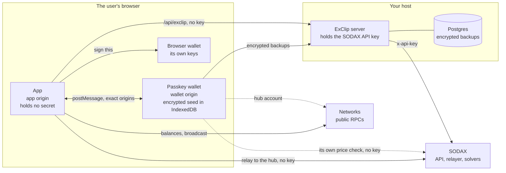

The app shows markets, builds swaps and follows them until they settle. It
asks a browser wallet, or the passkey wallet in its own window, to sign. The
two windows talk only to each other, each checking the other's exact
origin. The browser keeps the storage of the two origins apart, so even a
script injected into the app page can't read the wallet's keys
([architecture](docs/architecture.md#two-origins)).

**Where the keys live**

| Secret | Where it lives | Who can use it |
|---|---|---|
| The SODAX API key | The server's memory, from `SODAX_API_KEY` or the config | The server, which sends it only to SODAX |
| A browser wallet's keys | That wallet | That wallet, after its own review |
| The passkey wallet's seed | Encrypted in the wallet origin's IndexedDB, and in an encrypted backup on the server | The wallet window only, after a fresh passkey prompt |
| The passkey | The user's device or password manager | The user. The server keeps only its public key |

**Why the SODAX key never reaches the browser.** SODAX wants an API key on
its requests, and a key shipped in the app could be copied by anyone. So
the app and SODAX's SDK call `/api/exclip/sodax/…` on the app's own origin.
The server lets through only 19 allow-listed routes, and only their own
query parameters. It adds the key as `x-api-key`, and sends back only the
status and the body, with the key cut out wherever it appears. Errors and
log lines get the same redaction. Each build takes a field-by-field
projection of the public settings, and tests fail if a secret could reach a
bundle ([why the key stays home](docs/architecture.md#why-the-sodax-key-never-reaches-the-browser)).

| Path | What |
|---|---|
| [`apps/web`](apps/web) | The app: React and Vite. Home, asset, pair and portfolio screens, and the trade sheet |
| [`apps/wallet`](apps/wallet) | The passkey wallet window: plain TypeScript, its signing policy, price checks and review |
| [`apps/server`](apps/server) | Express 5 on Node 24: public config, market data, the SODAX proxy, backups, rate limits |
| [`packages/config`](packages/config) | Reads and checks `exclip.config.ts`, decides what each build may see, and defines both origins' security headers |
| [`packages/clip-wallet-*`](packages) | Clip Wallet's vault and key code, vendored |
| [`docs`](docs/README.md) | Concepts, architecture, configuration, self-hosting, branding, the wallet, fees, security, the API, development, troubleshooting and an FAQ |
| [`brand`](brand/README.md) | ExClip's mark, wordmark and colours |

## Fees

ExClip charges no fee unless the operator sets one. A swap then costs the
source network's gas, and SODAX's fee, which is included in the rate. The
review says both.

An operator can add a partner fee of up to 1 %. It fails closed at every
step, so a mistake means no fee rather than a wrong one:

- **The config** refuses a fee without a receiver, a fractional rate, or
  more than 100 basis points, and the server won't start with one.
- **The server** pins the configured fee on every quote and intent, and
  drops any fee the browser sends. A browser can't add, raise, lower or
  redirect it.
- **The passkey wallet** signs a fee only to an address in
  `apps/wallet/fee-receivers.json`. That file ships empty and changes only
  through a reviewed commit, so until someone adds a receiver, the wallet
  refuses every swap that carries a fee.

[Fees](docs/fees.md) shows what the review displays, and how to turn a fee
on and off.

## Security

- **The SODAX key stays on the server.** No build can carry a secret, and
  the proxy cuts the key out of every answer and log line.
- **No fee by default, and fee receivers fail closed,** as above.
- **The passkey wallet is isolated.** It has its own origin and its own
  passkeys. Its CSP runs only its own code, enforces Trusted Types and
  forbids framing, and it may call exactly two outside URLs: SODAX's quote
  endpoint and Sonic's RPC.
- **No blind signing.** The wallet decodes every transaction and matches it
  to what the person asked for: the tokens, the amounts, the networks, the
  deadline, and that the money comes back to this wallet. It refuses
  anything else, and it has no way to sign a message or typed data.
- **A price check of its own.** Between two dollar stablecoins, the wallet
  refuses a minimum below 97 % of what you pay. For other pairs, a minimum
  more than 5 % under its own SODAX quote brings up a full-screen warning.
- **Backups the server can't read.** They're encrypted in the wallet window,
  and stored append-only. Each read or write needs a fresh passkey signature
  on a single-use challenge.

[Security](docs/security.md) lists 22 invariants with the test that proves
each one, and the known limitations.

Report a vulnerability privately, as [SECURITY.md](SECURITY.md) explains,
never in a public issue.

## Operator responsibility

If you deploy ExClip, you provide your own front end to SODAX, and you
answer for it. ColdAI publishes the code; it doesn't run your copy. That
includes:

- **Your own brand.** A copy you run for other people uses its own name and
  logo.
- **Your own licensing and legal review**, in every place you offer it:
  whether you may offer swaps there, your terms of use and privacy notice
  (`brand.termsUrl` and `brand.privacyUrl`), and what charging a fee means.
- **Running it safely:** keeping it up to date, guarding the wallet origin
  like a signing key, backing up the database, and telling people who runs
  it (`brand.operator`).

ColdAI LLC doesn't operate your deployment, isn't a party to anything
between you and your users, and gives no warranty (see [LICENSE](LICENSE)).

## Not included

This repository is ExClip's first version: swaps only. It doesn't include:

- **Tokenised stocks**, or the eligibility and attestation checks that go
  with them. The app hides them, and the server refuses any quote or intent
  that names one.
- **Privacy mode.**
- **The Earn page.**
- **ColdAI's accounts, site shell and hosting setup.**

## Status

| Area | State |
|---|---|
| App | Market swaps, limit orders, asset and pair pages, and the portfolio. Live networks only: there is no test-network mode |
| Passkey wallet | Market swaps, sends and receives on 14 EVM networks. No limit orders yet |
| Server | One Node 24 process, on Postgres and optionally Redis. Serves both builds, or sits behind your own web server or CDN |
| Tests | 226 passing: 93 in the wallet, 89 in the server, 30 in the app and 14 in the config package. CI runs them on every push to `main` and every pull request |
| Security | No independent audit yet |
| Releases | No tagged release yet. `main` is version 0.1.0 |

## Roadmap

These gaps are known. None of them has a date.

1. An independent security audit.
2. Limit orders, and cancelling them, from the passkey wallet.
3. Swaps from the passkey wallet that pay out to another address.
4. Networks beyond EVM in the passkey wallet, such as Bitcoin and Solana.
5. Tagged releases.
6. A test that keeps the market-data list in step with the catalogue.

## Contributing

Contributions are welcome. Read [CONTRIBUTING.md](CONTRIBUTING.md) first.

- Every commit needs a [DCO](https://developercertificate.org/) sign-off
  (`git commit -s`), and commit messages follow `type(scope): summary`.
- `pnpm typecheck`, `pnpm lint`, `pnpm test` and `pnpm build` must pass.
- A change to the fee allow-list, the wallet window, the message protocol,
  the security headers or the config rules gets a line-by-line review. A
  tighter limit needs no discussion; a looser one needs an issue and
  agreement first.
- The vendored Clip Wallet packages are fixed upstream, not here.

Please follow the [code of conduct](CODE_OF_CONDUCT.md). Changes are listed
in [CHANGELOG.md](CHANGELOG.md). Never put an API key, a recovery phrase or
a private key in an issue, a pull request or a test.

## Licence and trademarks

ExClip is licensed under the [Apache License 2.0](LICENSE), © 2026 ColdAI
LLC. The vendored Clip Wallet packages keep the MIT licence they were
published under. [NOTICE](NOTICE) covers both.

"ExClip", "Clip Wallet" and the ExClip logo are trademarks of ColdAI LLC,
and the Apache License grants no rights to them (section 6). You may say
that your service is built on ExClip. A copy you run for other people must
use its own name and logo: set `brand.name` and `brand.logo`
([branding](docs/branding.md)). The [brand kit](brand/README.md) is for
ExClip itself.

## Credits

- **[ColdAI](https://coldai.org)** built ExClip and publishes it.
- **[SODAX](https://sodax.com)** is the swap network underneath. Its API
  quotes and builds every swap, and its relayer and solvers settle it.
  ExClip uses SODAX's SDK.
- **[Clip Wallet](https://github.com/ColdAI-org/clip-wallet)** gives the
  passkey wallet its vault and key code. A passkey wallet's recovery phrase
  imports into Clip Wallet, with the same addresses.
- Prices and charts come from [CoinGecko](https://www.coingecko.com). The
  wordmark is set in [Inter](https://rsms.me/inter/), under the SIL Open
  Font License.

<p align="center"><sub>Built by <a href="https://coldai.org">ColdAI</a>, a frontier R&amp;D lab building agentic AI and distributed-ledger systems.</sub></p>
