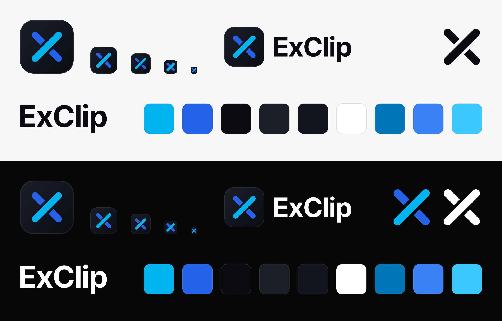

# ExClip brand

  
  &nbsp;
  

**Name.** ExClip, one word, with a capital E and a capital C. Not "Exclip", "EXCLIP" or "Ex-Clip".

**Mark.** An X made of two routes crossing on a dark tile: blue from top left to bottom right, cyan from bottom left
to top right. Cyan runs over unbroken; blue stops short on both sides of it, so the two routes never touch. That gap
is the idea: value crosses from one chain to another with no bridge joining them, because a solver fills the swap on
the far side (see [concepts](../docs/concepts.md)). The mark is a redrawing of the one the app first shipped with:
straight routes on a 64 grid, round outer ends, cuts parallel to the cyan route, and a gap of 3 units (2.3 px at
48 px). Below 48 px the gap would blur, so the small mark drops it.

## Files

| File | Use |
|---|---|
| `exclip-mark.svg` | App icon: the crossing on a dark rounded tile. 48 px and up, and the source for the 180, 192 and 512 px app icons |
| `exclip-mark-small.svg` | 16 to 32 px: a flat tile, heavier routes and no gap. The app's favicon and in-app mark (`apps/web/public/logo.svg` is a copy) |
| `exclip-glyph-{color,white,ink}.svg` | The crossing alone, on a transparent background. Colour on dark only; white on dark or on colour; ink on light |
| `exclip-wordmark-{ink,white}.svg` | "ExClip" in Inter Bold, −2.5% tracking, outlined (no font needed) |
| `exclip-lockup-{ink,white}.svg` | Mark + wordmark. Ink for light backgrounds, white for dark |
| `preview.png` | Review sheet (light and dark), not shipped |

The SVGs are written by hand. The wordmark's path is the output of `pnpm run brand:outline` (`tools/brand/outline.mjs`,
which outlines Inter Bold from `@fontsource/inter` with opentype.js). `pnpm run brand` (`tools/brand/render.mjs`)
checks the SVGs (a viewBox and a title in each, outlines only, brand colours only, every copy of the routes matching
the mark and every copy of the wordmark matching the outline), then renders `preview.png`, copies the small mark to `apps/web/public/logo.svg` and renders the app icons in
`apps/web/public/icons/`: 180 px for iOS, 192 and 512 px for the web app manifest, and a 512 px maskable icon whose
X stays inside the safe zone. Never edit those by hand; edit the SVG here and run `pnpm run brand` again.

## Colour

| Token | Hex | Use |
|---|---|---|
| Cyan | `#00B4F0` | The route on top. The app's accent: buttons, focus rings and links on the dark canvas |
| Blue | `#2563EB` | The route underneath |
| Night | `#0B0D12` | Wordmark and glyph on light backgrounds; the dark end of the tile |
| Tile | `#1A1E28` | The light end of the tile (top left) |
| Small tile | `#12151D` | The small mark's flat tile |
| White | `#FFFFFF` | Wordmark and glyph on dark backgrounds |
| Cyan ink | `#0077B6` | Cyan-coloured **small text** and focus indicators on light surfaces (the app's `accentInk`) |
| Blue light | `#3B82F6` | Blue-coloured small text on dark surfaces |
| Cyan hover | `#38C8FF` | Hover and pressed accent on the dark canvas (the app's `accentHover`) |

Contrast ratios, as `pnpm run brand` prints them. The two canvases are the app's light and dark backgrounds.

| Colour | White `#FFFFFF` | Light canvas `#F6F7F9` | Dark canvas `#07080A` | Night `#0B0D12` | Tile `#1A1E28` |
| --- | ---: | ---: | ---: | ---: | ---: |
| Cyan `#00B4F0` | 2.39:1 | 2.23:1 | 8.38:1 | 8.13:1 | 6.97:1 |
| Blue `#2563EB` | 5.17:1 | 4.82:1 | 3.88:1 | 3.76:1 | 3.22:1 |
| Night `#0B0D12` | 19.43:1 | 18.13:1 | 1.03:1 | — | 1.17:1 |
| White `#FFFFFF` | — | 1.07:1 | 20.04:1 | 19.43:1 | 16.66:1 |
| Cyan ink `#0077B6` | 4.87:1 | 4.54:1 | 4.12:1 | 3.99:1 | 3.42:1 |
| Blue light `#3B82F6` | 3.68:1 | 3.43:1 | 5.45:1 | 5.28:1 | 4.53:1 |
| Cyan hover `#38C8FF` | 1.93:1 | 1.80:1 | 10.37:1 | 10.06:1 | 8.63:1 |

### The contrast issues, and what we did

WCAG 2.2 asks for 4.5:1 for normal text (SC 1.4.3), and 3:1 for large text (≥ 24 px, or ≥ 18.66 px bold) and for
icons and UI component boundaries (SC 1.4.11).

- **Cyan is for dark surfaces.** It is 8.38:1 on the dark canvas but 2.39:1 on white and 2.23:1 on the light canvas,
  too light for text or thin lines there. On light surfaces the app writes accent-coloured small text, and draws focus
  rings and input focus borders, in Cyan ink (4.87:1 on white, 4.54:1 on the light canvas), above the 3:1 a focus
  indicator needs. The colour glyph is for dark backgrounds only. On light, use the mark (its tile carries the colours)
  or the ink glyph.
- **Blue is for light surfaces, as text.** It is 5.17:1 on white but 3.88:1 on the dark canvas: enough for the mark
  (3.22:1 against the tile, above the 3:1 for graphics) and not enough for small text. Blue small text on dark uses
  Blue light (5.45:1 on the dark canvas). The app has no blue text today.
- **Buttons** put a dark label, `#03141C`, on the accent: 7.84:1 on Cyan and 9.70:1 on Cyan hover.
- **The two routes** are 2.16:1 against each other, too close to tell apart by lightness alone where they meet. The
  full mark separates them with the gap. In the small mark cyan stays on top, and the hue change carries the crossing
  at 16 and 32 px.
- **The tile on the dark canvas** is 1.20:1 (the small tile 1.10:1), so its edge all but disappears on the app's
  background. The full mark has a hairline edge (white at 8%) for that. At small sizes the routes carry the mark on
  their own: 7.64:1 (Cyan) and 3.53:1 (Blue) against the small tile.

An operator who changes the accent colours must keep the same ratios; [branding](../docs/branding.md) has the rule.
Ratios are computed with the WCAG 2.2 relative-luminance formula in `tools/brand/render.mjs`.

## Use

- **Clear space:** at least a quarter of the mark's width on every side. In the lockup, the gap between mark and word
  is that quarter.
- **Minimum size:** the full mark from 48 px; the small mark from 16 px up to 47 px; the lockup at least 32 px tall;
  the wordmark at least 16 px tall.
- **Which file where:** on light backgrounds, the mark, the ink lockup, the ink wordmark or the ink glyph. On dark
  backgrounds, the mark, the white lockup, the white wordmark, or the colour or white glyph. On a coloured or
  photographic background, the white glyph on a calm area.
- **Don't** recolour or swap the routes (cyan always runs on top), close the gap in the full mark, add one to the small
  mark, add shadows, glows or outlines, rotate, skew or stretch the mark, put it on a busy photo, or retype the name in
  another typeface: use the outlined wordmark.
- **Forks and other operators** must use their own name and logo (`brand.name` and `brand.logo` in
  `exclip.config.ts`; see [branding](../docs/branding.md)). "ExClip" and the ExClip logo are ColdAI trademarks and
  aren't licensed under Apache-2.0 (section 6 grants no trademark rights; see [`NOTICE`](../NOTICE)).
- Wordmark typeface: [Inter](https://rsms.me/inter/) © The Inter Project Authors, SIL Open Font License 1.1.
