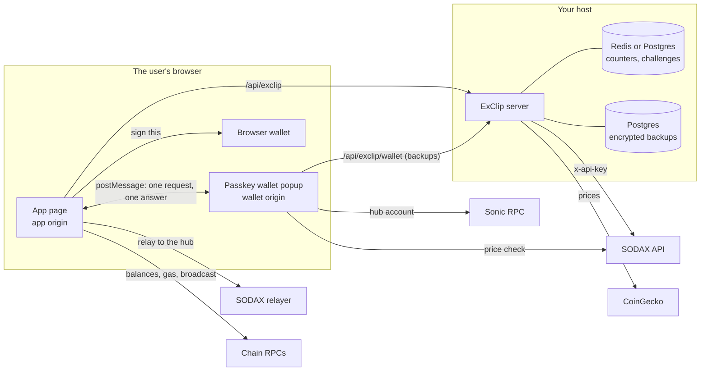

# Architecture

ExClip is two browser apps and one small server. The app shows markets and
builds swaps. The optional passkey wallet signs them, in a popup on an
origin of its own. The server holds the SODAX API key, serves market data
and keeps the wallet's encrypted backups. It can also serve both apps, so a
deployment can be a single Node process.

This page shows how the parts fit, where each key lives, and why the SODAX
key never reaches a browser. [Concepts](concepts.md) explains the swap
itself.

## The parts

| Part | Path | What it is | Where it runs |
|---|---|---|---|
| App | `apps/web` | React app: markets, the trade sheet, pair pages, the portfolio, and the app's half of the passkey wallet | The browser, on the app origin |
| Wallet | `apps/wallet` | Plain TypeScript popup: the passkey vault, the signing policy and its own review screens | The browser, on the wallet origin |
| Server | `apps/server` | Express 5 on Node 24: public config, market data, the SODAX key proxy, the wallet's backup API, rate limits; optionally the two builds | Your host |
| Config | `packages/config` | Reads and checks `exclip.config.ts`, decides what each build may see, and defines both origins' security headers | Build time, and server start |
| Clip Wallet | `packages/clip-wallet-vault`, `packages/clip-wallet-core` | Clip Wallet's vault and key code, vendored | Inside the wallet popup |

The app has four screens: home (`/`), an asset (`/asset/ETH`), a pair
(`/trade/BTC-USDC`) and the portfolio (`/portfolio`). When the operator
switches tokenised stocks on, a fifth lists them (`/stocks`). Trading,
sending, receiving and connecting a wallet open as sheets over whichever
screen is showing.

## How the parts talk

- **App to server.** Everything under `/api/exclip`: the public config,
  market data, and SODAX calls through the key proxy. The SODAX SDK in the
  browser is set up with the proxy as its API address, so its quote, build
  and status calls go there too ([API](api.md)).
- **App to the chains.** The SDK reads balances and gas from public RPCs,
  and calls SODAX's relayer directly. A browser wallet signs and broadcasts
  with its own connection. For the passkey wallet, the app broadcasts what
  the popup signed.
- **App to popup.** Messages go only between the app's window and the popup
  it opened, each checking the other's exact origin. Every message has a
  fixed shape, and the popup answers with public data only: addresses,
  signed transactions and hashes
  ([embedded wallet](embedded-wallet.md#messages-between-the-app-and-the-popup)).
- **Popup to the outside.** The wallet's CSP lets it reach exactly three
  places: its own origin (for the backup API), SODAX's quote endpoint (for
  its own price check) and Sonic's public RPC (to look up the hub account).
- **Server to the outside.** SODAX, with the key; CoinGecko, for prices; and
  your Redis and Postgres.

## Two origins

A deployment uses two web addresses, for example `https://exclip.example.com`
for the app and `https://wallet.exclip.example.com` for the wallet. The
browser keeps their storage apart, so a script on the app page, whether a
bug, an injected script or a bad dependency, can't read the wallet's vault.
Passkeys are bound to the wallet's host, so no other site can use them.

| | App origin | Wallet origin |
|---|---|---|
| Serves | The app and the API, without the wallet's routes | The wallet page, its hashed files and its backup API, nothing else |
| Scripts | `script-src 'self'`: the app's own files, no inline script | `script-src 'self'`, plus Trusted Types enforced |
| Network | `connect-src 'self' https: wss:`, because browser wallets and the SDK talk to many RPCs | `connect-src` lists exactly three destinations (above) |
| Passkeys | Switched off by the Permissions-Policy | Allowed, for this origin only |
| Framing | `frame-ancestors 'none'` and `X-Frame-Options: DENY` | The same |
| Cookies, CORS headers | The server sets none | Removed from every response |
| Caching | Pages `no-store`, hashed files for a year, other files `no-cache` | `no-store` on everything, so a fixed build is what runs next time |

Both sets of headers are defined once, in
[`packages/config/src/headers.ts`](../packages/config/src/headers.ts). The
dev servers send them without the CSP (Vite's dev client needs inline
code), and `vite preview` and `apps/server` send them in full. If you put
another web server in front, send exactly these
([self-hosting](self-hosting.md#5-serve-the-two-origins)).

Each build bakes in the two origins from `exclip.config.ts`. The app trusts
only its configured wallet origin, and the wallet answers only its
configured app origin. The server's `/config` answer can switch the wallet
off, but it can't point the app at another wallet.

## Where the keys live

| Secret | Where it lives | Who can use it |
|---|---|---|
| SODAX API key | The server's memory, from `SODAX_API_KEY` or the config file | The server, which sends it to SODAX only, in the `x-api-key` header |
| CoinGecko key (optional) | The server's memory | The server, for market data |
| Database and Redis URLs | The server's environment | The server |
| A browser wallet's keys | The wallet extension or app | That wallet. ExClip asks it to sign, and it shows its own review |
| The passkey wallet's seed | Encrypted in IndexedDB on the wallet origin, plus an encrypted backup on the server | The popup only, after a fresh passkey prompt, one request at a time |
| The passkey itself | The user's device or password manager | The user. The server stores only its public key |
| The tokenised-stock secrets, when stocks are on | The server's environment, `EXCLIP_EDGE_SECRET` and `EXCLIP_ATTESTATION_SECRET`. Your reverse proxy holds the edge secret too | The server, to trust the country header and to sign self-certifications. The proxy only sends the edge secret ([tokenised stocks](tokenised-stocks.md#the-reverse-proxy)) |

The app holds no secret at all. Its build gets a projection of the config,
picked field by field (the brand and the two origins). The wallet's build
gets the app origin it answers, its own origin, the brand name, the
operator, the deposit limit and whether tokenised stocks are on. A test
checks that no secret can reach either bundle.

## Why the SODAX key never reaches the browser

SODAX wants an API key on its requests. Shipping it in the app would let
anyone copy it, so the browser never gets it:

1. The app and the SDK call `/api/exclip/sodax/...` on the app's own origin.
2. The server checks the method and path against an allow-list of 19 routes
   ([API: SODAX](api.md#sodax)) and drops every query parameter the route
   doesn't use.
3. It adds the key as `x-api-key`, sends the request to SODAX, and ignores
   any key the browser sent.
4. It sends back only the status and the body, with the key cut out
   wherever it appears. No header from SODAX is copied onto the answer.
5. Error answers and log lines go through the same redaction.

Four tests named "SODAX key 1/4" to "SODAX key 4/4" in
`apps/server/test/app.test.ts` check each of these paths
([security](security.md#invariants-and-how-they-are-tested)).

The same proxy is where the operator's settings are enforced. It pins the
configured partner fee, or a [fee split](fee-split.md#the-server)'s amount
for that swap, on every quote and intent, and drops any fee the browser
sends ([fees](fees.md)). It refuses tokenised stocks, unless the
operator has switched them on and the visitor passes the stock check
([tokenised stocks](tokenised-stocks.md#who-may-trade-them)). It refuses to
build trades while trading is switched off. The cost of this design is that
the proxy is public: anyone can call the allowed routes with your key,
within the rate limits ([known limitations](security.md#known-limitations)).

## What the server keeps

| What | Where | For how long |
|---|---|---|
| Rate-limit counters, shared by every server process | Redis, else Postgres, else memory | 65 seconds after the client's last counted request. Postgres and memory delete expired entries at a later sweep |
| Rate-limit burst buckets, per process | Process memory | The 50,000 most recent clients |
| One-time wallet challenges | Redis, else Postgres, else memory | 2 minutes |
| The count of new passkeys today | Redis, else Postgres, else memory | 2 days |
| Passkeys (public key, sign count, transports) and encrypted backups | Postgres, else memory | Until the passkey is retired. The first new registration 30 days after that deletes it |
| SODAX's token list and deadline | Process memory | 5 minutes and 30 seconds |
| Market data | Process memory | 60 seconds; the last good list is kept for 15 minutes |

`pnpm start` refuses to run on memory storage unless
`server.allowMemoryStore` is set, because backups would vanish on a restart.
The server writes no request log ([self-hosting](self-hosting.md#monitoring)).

## What the browser keeps

| What | Where | Notes |
|---|---|---|
| Trade history (`exclip.activity.v1`) | The app origin's `localStorage` | Up to 500 entries. Never sent to the server. The portfolio exports it as CSV |
| Theme, and whether to reconnect a browser wallet | The app origin's `localStorage` | |
| The passkey wallet session | The app origin's `sessionStorage` | The wallet's address and whether it's backed up. Gone when the tab closes |
| The tokenised-stock self-certification (`exclip.stocks.attestation`) | The app origin's `localStorage` | Only where stocks are on. Signed by the server, valid for 30 days, and sent only to the SODAX proxy and the stock routes |
| The passkey wallet's vault | The wallet origin's IndexedDB | Encrypted. The app can't read it |

Browser wallets and their connectors may keep their own data too.

## Development and production

`pnpm dev` runs three processes: the app on `http://localhost:5173`, the
wallet on `http://localhost:5311`, and the server on port 8080, with both
dev servers passing `/api` to it. Development ignores the configured origins
and uses those localhost ones.

In production you build both apps and run the server with `pnpm start`.
Either the server serves both builds, choosing by the request's host name
(`server.serveStatic`), or your own web server or CDN does, with the same
headers. [Self-hosting](self-hosting.md) walks through both.
