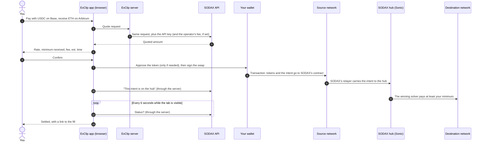

# Concepts

ExClip is a front end for [SODAX](https://sodax.com), a cross-chain swap
network. You pick what to pay with and what to receive, on any of the
networks SODAX supports, and ExClip asks SODAX for a price. If you accept it,
your wallet signs one transaction on the network you pay from. SODAX's
solvers compete to fill it, and what you bought arrives on the network you
chose.

ExClip never holds your funds or sees a private key, and it doesn't match
orders or bridge anything itself. It shows prices, builds the request, and
follows it until it settles. This page explains how that works, and the
words the rest of the documentation uses.

## What ExClip is, and isn't

| ExClip is | ExClip isn't |
|---|---|
| A web app that quotes, builds and tracks swaps | A custodian: the funds stay in your wallet until a solver fills your order |
| A small server that holds the SODAX API key and serves the app | An exchange with an order book: SODAX's solvers set the price |
| An optional passkey wallet on its own origin | A bridge: SODAX moves the value, through its hub on Sonic |
| Something you can run, rebrand and host yourself | A broker: whoever runs a copy is responsible for it ([operator responsibility](../README.md#operator-responsibility)) |

## A swap, from click to settlement

1. **Quote.** The app asks for an `exact_input` quote: you pay a fixed
   amount, and SODAX says how much you would get. The request goes to the
   ExClip server, which adds the API key and pins the operator's partner fee.
   The key never reaches the browser. While you review, the quote refreshes
   every 20 seconds.
2. **Minimum.** The app turns the quote into a minimum: the quote less your
   slippage (0.1 %, 0.5 % or 1 %; 0.5 % is the default). A solver must
   deliver at least that much, or the swap doesn't happen.
3. **Approve.** If SODAX's contract can't spend your token yet, your wallet
   first signs an approval. A network's own coin needs none.
4. **Sign.** Your wallet signs one transaction on the source network. It
   hands your tokens to SODAX's contract with an *intent*: what you pay, what
   you want, where it goes, the minimum and a deadline.
5. **Relay.** SODAX's relayer carries the intent to the SODAX hub on Sonic. A
   swap from Sonic itself skips this step.
6. **Solve.** Solvers compete to fill the intent. The winner delivers the
   output to your address on the destination network. If no solver fills it,
   SODAX reports it as failed, and your funds stay in your wallet or are
   returned automatically.
7. **Track.** The app asks SODAX for the intent's status every 6 seconds
   while the tab is visible, and records the result in this browser's
   activity log.

Before you confirm, the trade sheet shows an estimated time: the source
network's usual confirmation time, plus 20 seconds on the hub, plus the
destination's. The confirmation times are typical figures from
[`apps/web/src/lib/catalog.ts`](../apps/web/src/lib/catalog.ts), not
promises.

## Market swaps and limit orders

| | Market swap | Limit order |
|---|---|---|
| Where | The trade sheet (Buy, Sell, Convert) | A pair's page, for example `/trade/BTC-USDC` |
| Price | The quote, less your slippage | The price you type |
| Deadline | 10 minutes after you confirm | 1 hour, 1 day (the default), 7 days, 30 days, or no expiry |
| Partial fills | No: all or nothing | Yes: it can fill in pieces until it's complete, cancelled or expired |
| Passkey wallet | Yes, between its networks | Not yet: use a browser wallet |
| Cancel | From the pair page's open orders, with a browser wallet | The same |

Both are SODAX intents. A limit order is an intent whose minimum comes from
your price instead of a quote, with a longer deadline (or none) and partial
fills allowed.

## Vocabulary

| Term | Meaning |
|---|---|
| **Intent** | A signed request to swap: input token and amount, output token, minimum output, deadline, and the source and destination networks and addresses. Solvers fill intents; nobody can change one after you sign it |
| **Solver** | A market maker that fills intents on SODAX. Solvers compete, so the best offer at the time wins |
| **Hub** | SODAX's settlement layer, on the Sonic network. Every swap is settled there, whatever networks it starts and ends on |
| **Spoke** | Any other network SODAX supports. SODAX's contract on a spoke (the asset manager) takes deposits and pays out |
| **Relayer** | SODAX's service that carries an intent from a spoke to the hub. The app talks to it directly |
| **Hub account** | Your account on the SODAX hub. SODAX's contracts give each wallet address one, and every intent you sign names it as the creator. The passkey wallet shows it as "Your SODAX account on Sonic" |
| **Quote** | SODAX's answer to "how much would I get for this?". It's a snapshot, so the app asks again every 20 seconds while you review |
| **Slippage** | How far below the quote you accept. It sets the minimum received |
| **Minimum received** | The least a solver may deliver. Below it, the swap doesn't happen |
| **Deadline** | When an unfilled intent stops being valid |
| **Partner fee** | An optional fee the operator takes from each swap, up to 1 %. It's zero unless the operator sets one ([fees](fees.md)) |
| **Network fee** | The gas your wallet pays on the source network, in that network's own coin. It goes to the network, not to ExClip |
| **Tokenised stocks** | Real-world-asset tokens that SODAX lists. ExClip doesn't offer them: the app hides them, and the server refuses any quote or intent that names one |
| **Browser wallet** | A wallet you already use, such as an extension or Clip Wallet. ExClip connects nine families: EVM, Solana, Sui, Bitcoin, Stellar, NEAR, Injective, Stacks and ICON |
| **Passkey wallet** | The optional wallet built into ExClip, unlocked with a passkey. It runs on its own origin ([the passkey wallet](wallet.md)) |
| **App origin, wallet origin** | The two web addresses a deployment uses, for example `https://exclip.example.com` and `https://wallet.example.com`. Keeping them apart is what protects the passkey wallet |
| **Operator** | Whoever runs a copy of ExClip. The operator chooses the brand, the fee and the hosting, and is responsible for that copy |

## Networks and assets

ExClip's catalogue names 36 assets and 22 networks, with their explorers, in
[`apps/web/src/lib/catalog.ts`](../apps/web/src/lib/catalog.ts). It holds
names and pictures only. Which networks an asset trades on, its contract
address and its decimals all come live from SODAX's token list. When SODAX
lists a catalogue asset on another network, the app offers it there without a
release. A new asset needs a catalogue entry
([development](development.md#add-an-asset)). Prices come from CoinGecko,
through the server ([API: markets](api.md#get-markets)).

With a browser wallet, you can trade on every network SODAX lists that your
wallet supports. The passkey wallet signs on 14 EVM networks: Sonic,
Ethereum, Base, Arbitrum, Optimism, Polygon, BNB Chain, Avalanche, HyperEVM,
LightLink, Kaia, Redbelly, Hedera and Robinhood Chain. It knows the 238
tokens in its own table, so its review can name exactly what you sign
([embedded wallet: networks](embedded-wallet.md#networks)).

## Where to go next

- [Architecture](architecture.md): the parts, the two origins, and where the
  keys live.
- [The passkey wallet](wallet.md): how it works in plain terms, and how to
  back it up.
- [Fees](fees.md): how the partner fee works, and why it fails closed.
- [Security](security.md): the trust model, and the test behind each
  promise.
